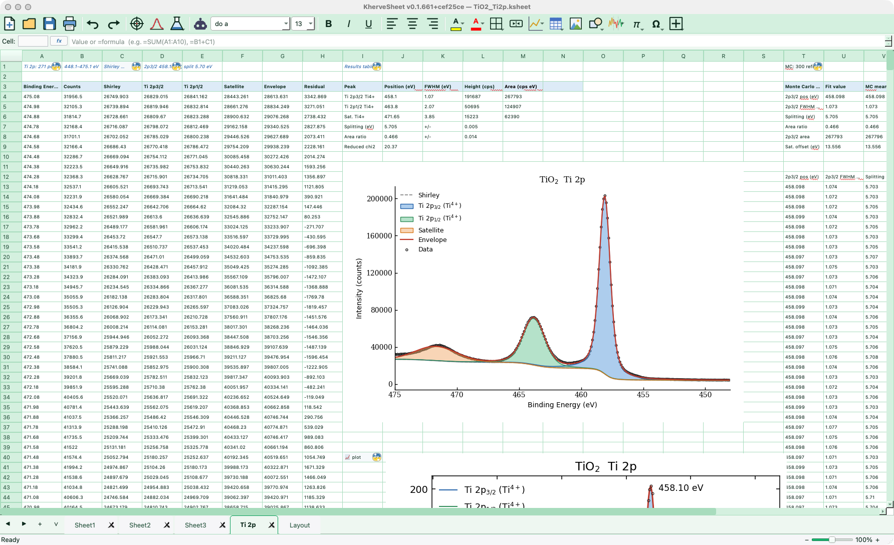

# KherveSheet

**An Excel-like spreadsheet for scientists, with Python in every cell and AI
assistants that work through the grid.**

[](https://doi.org/10.5281/zenodo.23317839)
[](https://github.com/gkerherve/KherveSheet/actions/workflows/tests.yml)
[](LICENSE)



## Statement of need

Spreadsheets are where most experimental scientists start: opening an
instrument export, tabulating results, making a quick plot. General-purpose
spreadsheets serve this work poorly. Their numerical tools are limited,
their charts need a lot of manual work to reach journal conventions, and
the logic sits in hidden formulas that are hard to check. Notebooks are
transparent, but they drop the grid scientists think in.

KherveSheet keeps the familiar grid and puts real code in it:

- **`=PY` cells.** Any cell can hold a full Python program, with imports,
  functions, loops and live data. It reads the grid with `ks("A1:B10")`,
  writes back with `ks_set(...)`, and has NumPy, SciPy, pandas and
  Matplotlib. A cell's last expression becomes its value: a number, a block
  of values, or an embedded figure.
- **Charts for publication.** Native charts support reversed axes,
  components filled to a baseline, minor ticks with independent directions on
  each edge, annotations, and PNG/SVG/PDF export.
- **Analysis tools.** An Excel-style Solver, 23 trendline models and
  lmfit-based peak fitting with Shirley, Tougaard or polynomial backgrounds.
- **More than 180 templates and worked examples.** These cover spectroscopy
  (XPS, Auger, UV-Vis, FTIR, Raman, EDX, XRF, XRD), materials
  characterisation (BET, TGA, DSC, Tauc, Hall effect), kinetics, signal
  processing, statistics and simulation, plus graded teaching exercises.
- **AI assistants over MCP.** A built-in
  [Model Context Protocol](https://modelcontextprotocol.io) server lets
  Claude Desktop, Claude Code, Cursor, VS Code, LM Studio or any other local
  MCP client work in the open workbook. Assistants compute by writing `=PY`
  cells, so every result is code you can read and re-run. See
  [docs/MCP.md](docs/MCP.md).
- **Excel compatible.** Reads and writes `.xlsx` and CSV; the native
  `.ksheet` format is HDF5.

## Installation

### Installers (recommended)

Download the Windows installer or the macOS DMG (Apple Silicon or Intel)
from the [KherveSheet page](https://khervetools.com/tools/khervesheet) or
from the [releases](https://github.com/gkerherve/Kherve-Downloads/releases?q=khervesheet).
The installers are not code-signed: Windows SmartScreen will warn, and on
macOS see [README.macos.md](README.macos.md) for the Gatekeeper step.

### From source

Python 3.12 or 3.13:

```bash
git clone https://github.com/gkerherve/KherveSheet.git
cd KherveSheet
python -m venv .venv
source .venv/bin/activate        # Windows: .venv\Scripts\activate
pip install -r requirements.txt
python KherveSheet.py            # or: python -m khervesheet
```

## Quick start

1. Open the **Examples** menu and pick a worked example, such as
   *XPS Spectrum* or *Peak Shapes*, or one of the Python examples.
2. Select two columns of data and choose **Insert ▸ Chart**.
3. Enter Python in a cell by starting it with `=PY` followed by a script, for
   example:
   ```
   =PY
   import numpy as np
   x = np.linspace(0, 10, 200)
   ks_set("A1", np.column_stack([x, np.sin(x)]).tolist())
   "200 points"
   ```
4. To let an AI assistant work in the sheet, open
   **AI ▸ Connect to Claude (Simple)…**, tick *Let assistants connect to this
   workbook*, connect your application, restart it, and mention
   "KherveSheet" in the chat.

A complete worked example is in [`paper/demo/`](paper/demo). There, an MCP
client fits the Ti 2p XPS spectrum of TiO₂ using only `=PY` cells (Shirley
background, Voigt doublet, charge-transfer satellite and a Monte Carlo error
analysis), then builds the figures with native charts. Run it with
KherveSheet open and the MCP bridge enabled:

```bash
python paper/demo/run_tio2_demo.py
```

## Running the tests

```bash
pip install pytest
pytest tests/          # on headless Linux: xvfb-run pytest tests/
```

The suite (over 450 tests) covers the formula engine against a golden
corpus of 245 formulas, the Qt-free core, `=PY` cells, charts, the Solver,
`.xlsx` round trips and the MCP server and tools.

## Citing

If you use KherveSheet in your research, please cite it. See
[CITATION.cff](CITATION.cff) or use the Zenodo DOI
[10.5281/zenodo.23317839](https://doi.org/10.5281/zenodo.23317839).

## Contributing and support

Bug reports, questions and contributions are welcome. See
[CONTRIBUTING.md](CONTRIBUTING.md).

## License

GPL-3.0. See [LICENSE](LICENSE).
